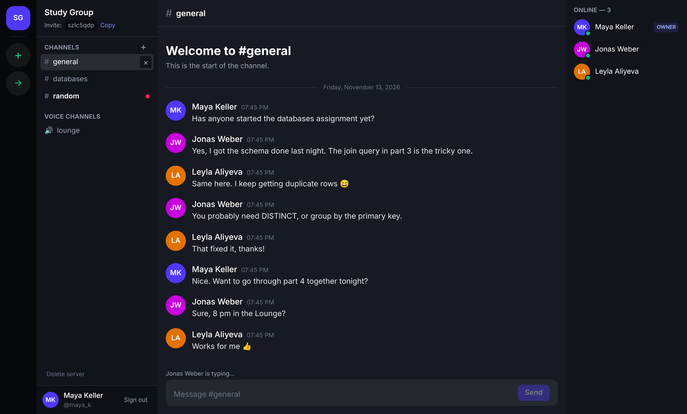
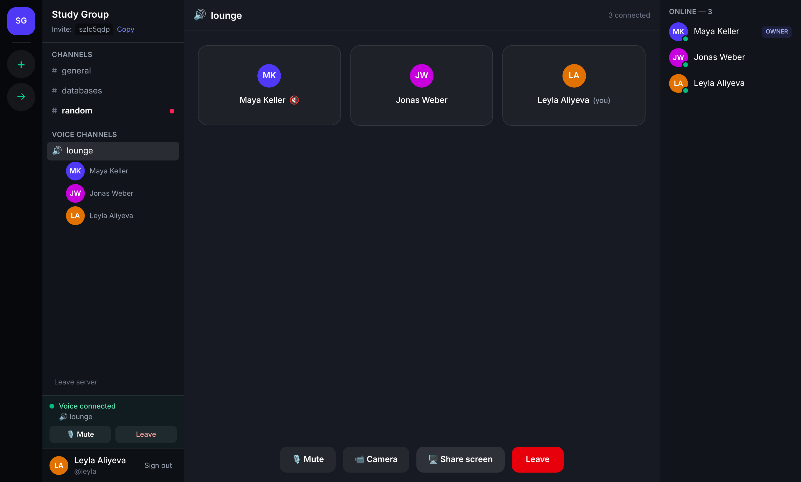
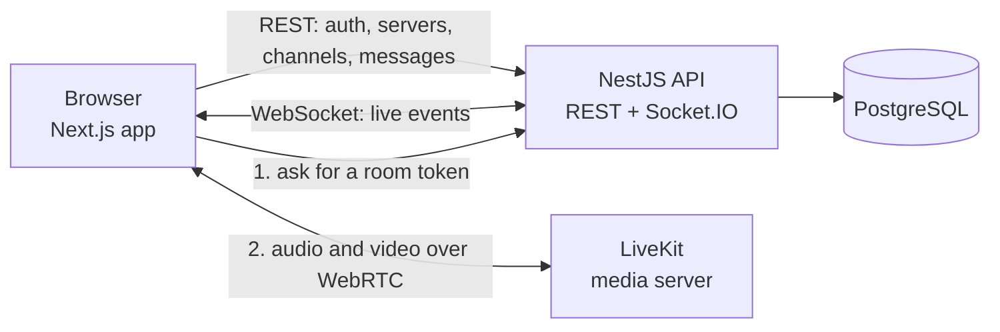

<h1 align="center">Pulse</h1>

<p align="center">
  <strong>Real-time chat, voice and video for communities.</strong><br />
  Servers, channels, live messaging and voice rooms in the browser.
</p>

<p align="center">
  <a href="https://pulse-mauve-pi.vercel.app"><strong>Live demo</strong></a>
  &nbsp;·&nbsp;
  <a href="#features">Features</a>
  &nbsp;·&nbsp;
  <a href="#architecture">Architecture</a>
  &nbsp;·&nbsp;
  <a href="#getting-started">Getting started</a>
</p>

<p align="center">
  <a href="https://github.com/uhuseynov/pulse/actions/workflows/ci.yml">
    
  </a>
</p>



> The demo's API runs on a free instance that sleeps when idle. The first request after a quiet period can take up to a minute; the app tells you while it waits.

## About

Pulse is a Discord-style communication platform built as a full-stack TypeScript monorepo. People create servers, invite others with a code, talk in text channels that update live, and join voice channels with camera and screen sharing.

It was built to learn how the pieces of a real-time product fit together: a REST API for state, WebSockets for live events, a media server for audio and video, and a relational database underneath, all tested and deployed.

## Features

**Messaging**

- Servers with invite codes and role-based permissions
- Text channels with persistent, paginated message history
- Messages, new channels and membership changes delivered live over WebSockets
- Typing indicators and unread markers per channel and per server
- Online and offline presence

**Voice and video**

- Voice channels that show who is inside before you join
- Speaking and muted indicators
- Camera and screen sharing
- The call stays connected while you browse text channels

**Accounts and safety**

- Registration and sign-in with salted scrypt password hashes and JWT sessions
- Every request is checked against server membership and role
- Input validation on every route, rate limiting, and a stricter limit on sign-in
- Security headers and an allow-list of web origins



## Tech stack

| Area | Technology |
|---|---|
| Web | Next.js 16, React 19, TypeScript, Tailwind CSS 4 |
| API | NestJS 12, TypeScript, Zod |
| Real time | Socket.IO |
| Voice and video | LiveKit (WebRTC) |
| Database | PostgreSQL 17, Prisma 7 |
| Testing | Jest, Supertest |
| CI | GitHub Actions |
| Hosting | Vercel (web), Render (API), Neon (PostgreSQL), LiveKit Cloud |

## Architecture



The browser talks to three things, each for what it is good at:

- **REST** changes and reads state. Sending a message is a `POST`; the API saves it and then announces it.
- **Socket.IO** carries events from the server to everyone who should see them. Each socket is authenticated with the user's token and joined to one room per server it belongs to, so an event reaches members and nobody else.
- **LiveKit** carries audio and video. The API never touches media. It only decides who may enter: a member asks for a token, the API checks that they belong to the channel's server, and signs a token that is valid for that one room for 15 minutes.

### Design decisions

- **Writes go through REST, not the socket.** A message is validated, authorised and stored by one code path, and the socket only broadcasts the result. The sender's own message is deduplicated by id when the broadcast arrives.
- **UUIDv7 primary keys.** They sort by creation time, so the message id doubles as the pagination cursor and no separate timestamp index is needed.
- **Non-members get 404, not 403.** A server's existence is not revealed to people outside it.
- **Voice is optional.** Without LiveKit keys the API starts normally, reports that voice is off, and the web app hides it.
- **Tests run against real PostgreSQL.** The end-to-end suite creates a throwaway database, applies the committed migrations and drives the HTTP and WebSocket interfaces.

### Known limitations

- Presence and voice occupancy are kept in memory, so the API must run as a single instance. Moving them to Redis is the next step for scaling out; the Redis service in `docker-compose.yml` is there for that work and is not used yet.
- The session token is stored in `localStorage`. The web app and API live on different domains, where cookie-based sessions are unreliable across browsers.
- Messages cannot be edited or deleted yet.

## Project structure

```text
pulse/
├── apps/
│   ├── api/                  NestJS backend
│   │   ├── prisma/           Schema and migrations
│   │   ├── src/
│   │   │   ├── auth/         Registration, sign-in, JWT guard
│   │   │   ├── servers/      Servers, invites, membership
│   │   │   ├── channels/     Text and voice channels
│   │   │   ├── messages/     History and sending
│   │   │   ├── realtime/     Socket.IO gateway and presence
│   │   │   ├── voice/        LiveKit tokens and room occupancy
│   │   │   ├── access/       Shared membership and role checks
│   │   │   └── config/       Environment validation
│   │   └── test/             End-to-end tests
│   └── web/                  Next.js frontend
│       └── src/
│           ├── app/          Routes: landing, login, register, app
│           ├── components/   Chat and voice UI
│           └── lib/          API client, chat state, voice hook
├── docs/screenshots/
├── .github/workflows/ci.yml
├── docker-compose.yml        PostgreSQL and Redis for development
└── render.yaml               Deployment blueprint for the API
```

## Getting started

### Prerequisites

- Node.js 24 or newer
- Docker Desktop
- Git

### 1. Clone and install

```bash
git clone https://github.com/uhuseynov/pulse.git
cd pulse
npm install
```

### 2. Configure the environment

```bash
cp apps/api/.env.example apps/api/.env
cp apps/web/.env.example apps/web/.env.local
```

Set `JWT_SECRET` in `apps/api/.env` to a long random value:

```bash
node -e "console.log(require('crypto').randomBytes(48).toString('base64url'))"
```

### 3. Start the database

```bash
docker compose up -d
npm run db:deploy
```

### 4. Run the apps

In two terminals:

```bash
npm run dev:api    # http://localhost:4000
npm run dev:web    # http://localhost:3000
```

Open `http://localhost:3000`, create an account and a server. To see live updates, sign in as a second user in a private window and join with the invite code.

### Environment variables

API (`apps/api/.env`):

| Variable | Required | Description |
|---|---|---|
| `DATABASE_URL` | Yes | PostgreSQL connection string |
| `JWT_SECRET` | Yes | At least 32 characters |
| `JWT_EXPIRES_IN` | No | Session lifetime, default `7d` |
| `WEB_ORIGIN` | No | Allowed web origins, comma-separated, default `http://localhost:3000` |
| `PORT` | No | Default `4000` |
| `AUTH_RATE_LIMIT` | No | Sign-in and sign-up attempts per minute per IP, default `10` |
| `LIVEKIT_URL` | No | LiveKit server URL, starts with `wss://` |
| `LIVEKIT_API_KEY` | No | LiveKit API key |
| `LIVEKIT_API_SECRET` | No | LiveKit API secret |

The three LiveKit variables must be set together. The API refuses to start with only some of them.

Web (`apps/web/.env.local`):

| Variable | Description |
|---|---|
| `NEXT_PUBLIC_API_URL` | URL of the API, default `http://localhost:4000` |

### Voice and video locally

Create a free project at [cloud.livekit.io](https://cloud.livekit.io), copy its URL, key and secret into `apps/api/.env`, and restart the API. A **Voice** option then appears when you create a channel.

## API

All routes except `/health`, `/voice/config`, `/auth/register` and `/auth/login` need an `Authorization: Bearer <token>` header.

| Method | Route | Description |
|---|---|---|
| GET | `/health` | Health check |
| POST | `/auth/register` | Create an account |
| POST | `/auth/login` | Sign in |
| GET | `/auth/me` | Current user |
| GET | `/servers` | Servers the user belongs to |
| POST | `/servers` | Create a server |
| POST | `/servers/join` | Join with an invite code |
| GET | `/servers/:serverId` | Server with channels, members and voice occupancy |
| POST | `/servers/:serverId/leave` | Leave a server |
| DELETE | `/servers/:serverId` | Delete a server (owner) |
| POST | `/servers/:serverId/channels` | Create a text or voice channel (owner, admin) |
| DELETE | `/channels/:channelId` | Delete a channel (owner, admin) |
| GET | `/channels/:channelId/messages` | History, newest page first (`before`, `limit`) |
| POST | `/channels/:channelId/messages` | Send a message |
| GET | `/voice/config` | Whether voice is available |
| POST | `/channels/:channelId/voice-token` | Token for joining a voice channel |

### Real-time events

Clients connect with Socket.IO to the API's origin, passing `auth: { token }`.

| Event | Direction | Meaning |
|---|---|---|
| `message:created` | Server to client | A message was posted |
| `channel:created`, `channel:deleted` | Server to client | The channel list changed |
| `member:joined`, `member:left` | Server to client | Membership changed |
| `server:deleted` | Server to client | A server was removed |
| `presence:changed` | Server to client | A member went online or offline |
| `voice:participants` | Server to client | Who is in a voice channel |
| `typing` | Both | A member is typing in a channel |
| `voice:join`, `voice:leave` | Client to server | This client entered or left a voice channel |

## Testing

```bash
npm test            # unit tests
npm run test:e2e    # end-to-end tests, needs PostgreSQL running
npm run lint
```

There are 20 unit tests and 46 end-to-end tests. The end-to-end suite covers authentication, permissions, pagination, rate limiting, live delivery over WebSockets and voice access. It uses a separate `pulse_test` database, so development data is left alone.

Every push and pull request runs linting, the build and both test suites in GitHub Actions.

## Deployment

Pushing to `main` redeploys the web app and the API.

| Part | Host | Notes |
|---|---|---|
| Web | Vercel | Root directory `apps/web`, variable `NEXT_PUBLIC_API_URL` |
| API | Render | Defined in `render.yaml`; migrations run on every start |
| Database | Neon | Use the **direct** connection string, without `-pooler` in the host name |
| Media | LiveKit Cloud | Optional; add the three `LIVEKIT_*` variables on Render |

To deploy your own copy:

1. Create a Neon project and copy its direct connection string.
2. In Render choose **New > Blueprint**, select the repository, and enter `DATABASE_URL` and `WEB_ORIGIN`.
3. Import the repository in Vercel with root directory `apps/web` and set `NEXT_PUBLIC_API_URL` to the Render URL.
4. Set `WEB_ORIGIN` on Render to the Vercel URL. The API only accepts browsers from that origin.

## Roadmap

- [x] Accounts, servers, channels and message history
- [x] Live messaging, typing indicators, presence and unread markers
- [x] Voice channels, video and screen sharing
- [x] Automated tests, CI and deployment
- [ ] Direct messages and a friends list
- [ ] Editing and deleting messages
- [ ] Role management in the UI
- [ ] Redis-backed presence for running more than one API instance
- [ ] Idle status

## License

Released under the [MIT License](LICENSE).
